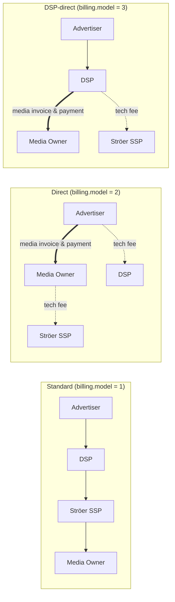

# OpenRTB & DOOH: Ströer Extensions vs. IAB Tech Lab Standard

Sep 28, 2026 · Markus Letzner

## Executive Summary

The Ströer specification “DSP Integration API 1.0” (dated 2026-01-12) lists DOOH as an inventory type, but still models DOOH technically via `site`/`app` + `banner`/`video` – without the DOOH building blocks available in OpenRTB 2.6: `BidRequest.dooh`, `Imp.qty` and `Imp.dt`. The only DOOH-related extension is `imp.ext.totalaud` (audience size, currently defined for linear TV/radio).

This leads to two kinds of proposals:

- **Alignment (Ströer → standard):** Move DOOH requests to `dooh`, `qty`, `dt`, `devicetype = 8`, `burl` and `deal.guar`; map `totalaud` to `qty.multiplier`.
- **Extension (standard ← Ströer / DOOH practice):** Propose as a community extension what OpenRTB 2.6 does not cover – playout context (loop, slot, share of voice, time window), screen properties, creative approval, proof-of-play macros and a new **`Billing` object** in the Deal that distinguishes standard settlement (DSP ↔ SSP), direct settlement (advertiser ↔ media owner) and DSP-direct settlement (DSP ↔ media owner).

The billing proposal is the most important point: today no OpenRTB field can express that a winning bid is **not** settled via the SSP → DSP chain. Reporting, invoicing and discrepancy reconciliation need this signal in the request and echoed in the bid.

## 1. Reference Framework: DOOH in OpenRTB 2.6 / AdCOM 1.0

Since OpenRTB 2.6, DOOH is a distribution channel of its own alongside Site and App. The relevant sections in [OpenRTB 2.6](https://github.com/InteractiveAdvertisingBureau/openrtb2.x/blob/main/2.6.md):

| Section | Attribute / object | What the standard says |
| --- | --- | --- |
| §3.2.1 BidRequest | `dooh` (object) | Should be included if the inventory is a DOOH screen. “A bid request must not contain more than one of a Site, App or DOOH object.” |
| §3.2.4 Imp | `qty` (object) | Multiplier for ads that display to more than one person (impression multiplier). |
| §3.2.4 Imp | `dt` (float) | Estimated time the impression will be displayed, Unix ms. |
| §3.2.31 Qty | `multiplier`, `sourcetype`, `vendor`, `ext` | Quantity per play; source (measurement vendor / publisher / exchange); name of the measurement vendor. |
| §3.2.32 DOOH | `id`, `name`, `venuetype`, `venuetypetax`, `publisher`, `domain`, `keywords`, `content`, `ext` | Placement or placement group, venue type per the chosen taxonomy, media owner. |
| §3.2.15 Publisher | `id`, `name`, `domain`, `cat` | Used within `dooh.publisher` (media owner). |
| §3.2.18 Device | `devicetype` | AdCOM List: Device Types, value 8 = out-of-home device. |
| §3.2.12 Deal | `guar`, `wadomain`, `at = 3` | Guaranteed deals and fixed price – the norm for programmatic guaranteed in DOOH. |
| §3.2.26 SupplyChainNode | `hp` | Indicates whether a supply chain node handles payment (payment handler). |
| §4.2.3 Bid | `burl`, `nurl`, `lurl` | Billing, win and loss notice. For DOOH, `burl` is the place to confirm the actual play. |
| §7.9 Implementation Notes | Digital Out-Of-Home | Guidance on multiplier, venue taxonomy and delayed playout. |

Known ambiguity in the standard: §3.2.32 names `venuetypetax`, while the example in §7.9 uses `venuetax` and `venuetypeid` ([Issue #49](https://github.com/InteractiveAdvertisingBureau/openrtb2.x/issues/49)). Implementers should settle on one spelling and parse the other leniently.

What the standard does **not** cover: loop and slot length, share of voice, playout window (only a single point in time), number of screens per package, approval by the media owner, proof-of-play details and the settlement model.

## 2. Analysis: Ströer SSP – DSP Integration API 1.0

The [Ströer specification](https://specs.myadscale.de/dsp-adapter/external/1.0.html#top) is an OpenRTB adapter document for versions 2.2 to 2.6, first price, EUR. DOOH is mentioned but not modelled on its own.

| Ströer section | Finding for DOOH |
| --- | --- |
| [Supported Inventory Types](https://specs.myadscale.de/dsp-adapter/external/1.0.html#header-supported-inventory-types) | “Digital Out of Home (DOOH): Digital billboard and screen inventory” – the only explicit mention of DOOH. No DOOH example, no rule on whether `site` or `app` is populated. |
| [BidRequest Object](https://specs.myadscale.de/dsp-adapter/external/1.0.html#header-bidrequest-object) | Knows `site`/`app`, but not `dooh`. |
| [Impression Object](https://specs.myadscale.de/dsp-adapter/external/1.0.html#header-impression-object) | `id`, format objects, `pmp`, `instl`, `tagid`, `bidfloor`, `bidfloorcur` (default EUR), `secure`, `ext`. No `qty`, no `dt`. |
| [Impression Object → ext](https://specs.myadscale.de/dsp-adapter/external/1.0.html#header-impression-object) | `totalaud` (float): “audience size for linear TV (video) or Radio”. Ströer-specific audience field; functionally the predecessor of `qty.multiplier`. |
| [Banner Extension Object](https://specs.myadscale.de/dsp-adapter/external/1.0.html#header-banner-extension-object) | `lightbox`, `sticky`, `scaling` – web special formats, not relevant for DOOH. |
| [Video Object](https://specs.myadscale.de/dsp-adapter/external/1.0.html#header-video-object) | Ad pod fields from 2.6 (`podid`, `podseq`, `rqddurs`, `poddur`, `slotinpod`, `mincpmpersec`). Technically usable for DOOH loops, but not described for that purpose. |
| [Device Object](https://specs.myadscale.de/dsp-adapter/external/1.0.html#header-device-object) | `devicetype` lists only values 1–7 of the AdCOM list; 8 (out-of-home) is missing. `w`/`h` available as screen pixels. |
| [Geo Object](https://specs.myadscale.de/dsp-adapter/external/1.0.html#header-geo-object) | `lat`/`lon`, `type`, `accuracy` – suitable for stationary screens, but without a DOOH rule (e.g. `type = 3`, user/publisher provided). |
| [Deal Object](https://specs.myadscale.de/dsp-adapter/external/1.0.html#header-deal-object) | `id`, `bidfloor`, `bidfloorcur`, `at` (1/2/3), `wseat`, `ext`. `guar` and `wadomain` are missing. No settlement signal. |
| [Source Object](https://specs.myadscale.de/dsp-adapter/external/1.0.html#header-source-object) | `schain` incl. `hp` (payment handler) – the only place in the request that says anything about payment flows. |
| [Bid Object](https://specs.myadscale.de/dsp-adapter/external/1.0.html#header-bid-object) | `nurl` with `${AUCTION_PRICE}`, `lurl`, `mtype`, `dur`, `dealid`. **No `burl`** – billing is tied to the win, not to the play. |
| [Bid Extension Object](https://specs.myadscale.de/dsp-adapter/external/1.0.html#header-bid-extension-object) | `avn` (advertiser name) and `agn` (agency name), both “always”. Valuable for direct settlement, because the publisher needs to know the invoice recipient. |
| [Supported Macros](https://specs.myadscale.de/dsp-adapter/external/1.0.html#header-supported-macros) | `${AUCTION_PRICE}`, `${AUCTION_PRICE:ENC}`, `${AUCTION_ID}`, `${AUCTION_BID_ID}`, `${AUCTION_IMP_ID}`, `${AUCTION_LOSS}`. No macros for multiplier or play time. |
| [General → Foreign Currencies](https://specs.myadscale.de/dsp-adapter/external/1.0.html#header-foreign-currencies-support) | All prices in EUR. Nothing on net/gross, fees or invoicing. |

**Interim conclusion:** Ströer’s DOOH “extensions” are in practice limited to `imp.ext.totalaud` plus the advertiser and agency names in `bid.ext`. The bigger task is adopting the 2.6 DOOH objects – and extending where 2.6 itself has gaps.

## 3. Gap Analysis: Ströer vs. OpenRTB 2.6

Of 14 DOOH-relevant requirements, Ströer 1.0 fully covers none (fixed-price deals and geo only partially), while OpenRTB 2.6 covers nine (rows 1–9). Five requirements (rows 10–14) are missing from both and are candidates for a Tech Lab extension.

| # | Requirement | Ströer 1.0 | OpenRTB 2.6 | Action |
| --- | --- | --- | --- | --- |
| 1 | DOOH channel instead of Site/App | missing (inventory list only) | §3.2.1 `dooh` | Alignment A1 |
| 2 | Placement / venue type | missing | §3.2.32 `venuetype`, `venuetypetax` | A1 |
| 3 | Media owner | only `site/app.publisher.id` | §3.2.32 `dooh.publisher` | A1 |
| 4 | Impression multiplier | `imp.ext.totalaud` (TV/radio) | §3.2.31 `qty.multiplier` | A2, `totalaud` → `qty` |
| 5 | Source of audience figure | missing | §3.2.31 `sourcetype`, `vendor` | A2 |
| 6 | Time of play | missing | §3.2.4 `dt` (single point in time) | A3 + E1 (time window) |
| 7 | OOH device type | values 1–7 | AdCOM Device Types 8 | A4 |
| 8 | Guaranteed deal | `at = 3` | §3.2.12 `guar`, `at = 3` | A5 |
| 9 | Billing on play | `nurl` on win | §4.2.3 `burl` | A6 + E4 |
| 10 | Loop, slot, share of voice | missing (ad pod for video only) | missing | E1 |
| 11 | Screen properties (orientation, diagonal, indoor/outdoor) | `device.w/h` | only `device.w/h` | E2 |
| 12 | Creative approval by media owner | missing | missing | E3 |
| 13 | Proof-of-play data (count, time, multiplier) | missing | only `burl`, no macros | E4 |
| 14 | Settlement model standard / direct / DSP-direct | missing | missing (`schain.hp` only indirectly) | **E5, E6** |

## 4. DOOH Extension Proposals (Tech Lab Format)

The proposals are written as they would appear in a pull request against the [openrtb2.x](https://github.com/InteractiveAdvertisingBureau/openrtb2.x) repository: object definition, attribute table (Attribute · Type · Definition), new lists. Until adopted, they run as a community extension under `ext` with identical names, so that only the path changes later.

### 4.1 Aligning Ströer with OpenRTB 2.6 (no change to the standard required)

| ID | Change in the Ströer spec | Standard reference |
| --- | --- | --- |
| A1 | DOOH requests send `BidRequest.dooh` instead of `site`/`app`; `dooh.publisher` = media owner; `venuetype` + `venuetypetax` per the OpenOOH taxonomy. | §3.2.1, §3.2.32 |
| A2 | Introduce `imp.qty`; mark `imp.ext.totalaud` as deprecated for DOOH and map it to `qty.multiplier`; populate `sourcetype` and `vendor`. | §3.2.4, §3.2.31 |
| A3 | Populate `imp.dt` with the scheduled time of play. | §3.2.4 |
| A4 | Add `device.devicetype = 8` (out-of-home) to the value list. | §3.2.18, AdCOM Device Types |
| A5 | Support `deal.guar` and `deal.wadomain`. | §3.2.12 |
| A6 | Support `bid.burl` and, for DOOH, fire it only after the play has been confirmed. | §4.2.3 |

### 4.2 E1 – Object: Playout (new, in `Imp`)

New attribute in §3.2.4 Imp:

| Attribute | Type | Definition |
| --- | --- | --- |
| `playout` | object | Details about how the impression opportunity is scheduled on a DOOH screen or network. Refer to Object: Playout. Recommended when a DOOH object is present. |

**Object: Playout** – describes the loop and time window in which the ad will be played.

| Attribute | Type | Definition |
| --- | --- | --- |
| `loopdur` | integer | Duration of the full content loop in seconds. |
| `slotdur` | integer | Duration of the ad slot in seconds. Creatives longer than `slotdur` must not be served. |
| `sov` | float | Share of voice offered, as a decimal between 0 and 1 (e.g. 0.1667 = 1 of 6 slots). |
| `plays` | integer | Number of plays of the creative that one win represents within the time window. |
| `dtstart` | float | Start of the playout window in Unix format (milliseconds since the epoch). If present, `imp.dt` should equal `dtstart`. |
| `dtend` | float | End of the playout window in Unix format (milliseconds since the epoch). |
| `screens` | integer | Number of screens covered by this impression opportunity when a network or package is sold as one unit; default 1. |
| `ext` | object | Optional exchange-specific extensions. |

### 4.3 E2 – Object: Screen (new, in `DOOH`)

New attribute in §3.2.32 DOOH:

| Attribute | Type | Definition |
| --- | --- | --- |
| `screen` | object | Physical characteristics of the display. Refer to Object: Screen. |

**Object: Screen**

| Attribute | Type | Definition |
| --- | --- | --- |
| `id` | string | Exchange- or media-owner-specific identifier of the physical screen or face. |
| `orient` | integer | Screen orientation: 1 = landscape, 2 = portrait, 3 = square. |
| `diag` | float | Screen diagonal in inches. |
| `env` | integer | Placement environment: 1 = indoor, 2 = outdoor, 3 = semi-outdoor (e.g. covered station). |
| `motion` | integer | Whether moving images are permitted: 0 = static only, 1 = motion allowed. Legal restrictions (e.g. roadside screens) must be reflected here. |
| `audio` | integer | Whether audio is played: 0 = muted, 1 = audio on. |
| `ext` | object | Optional exchange-specific extensions. |

### 4.4 E3 – Creative approval (new attribute in `Imp` and `Deal`)

| Attribute | Type | Definition |
| --- | --- | --- |
| `crapproval` | integer | Creative approval requirement set by the media owner: 0 = none, 1 = creative must be pre-registered and approved before serving, 2 = only creatives approved for this deal may be served. Refer to List: Creative Approval Modes. |

If `crapproval ≥ 1`, `bid.crid` must reference an approved creative ID; a non-approved ID is rejected with Loss Reason 202 (Creative Filtered – Pending Approval/Disapproved by Exchange) or a new code “Creative not approved by media owner”.

### 4.5 E4 – Proof-of-play macros (extension of §4.4 Substitution Macros)

| Macro | Definition |
| --- | --- |
| `${PLAY_COUNT}` | Number of confirmed plays represented by this billing notice. |
| `${PLAY_TS}` | Timestamp of the (first) confirmed play in Unix format (milliseconds). |
| `${QTY_MULTIPLIER}` | Multiplier actually applied for billing; may differ from `imp.qty.multiplier` in the request after measurement. |
| `${BILLING_MODEL}` | Value of `deal.billing.model` (see E5), so that receivers can separate financial from informational notices. |

Implementation Note: For DOOH, `burl` is called only after proof-of-play confirmation by the player, not when the creative is rendered. Substitution of `${AUCTION_PRICE}` remains CPM-based and refers to 1,000 contacts after applying `${QTY_MULTIPLIER}`.

## 5. Settlement Model Extension Proposal (E5, E6)

Proposal: a new **Object: Billing** in the Deal (§3.2.12) that specifies which parties settle media spend for the deal: DSP and SSP (standard), advertiser or agency and media owner (direct), or DSP and media owner (DSP-direct). The bid confirms the model via an echo (§4.2.3), and the macro `${BILLING_MODEL}` carries it into all notices.

**Money flow: standard, direct and DSP-direct settlement** (only in standard settlement does media spend flow through the SSP; dashed = tech fees only, no media spend)



| Model | Media spend flows | SSP role |
| --- | --- | --- |
| 1 `standard` | Advertiser → DSP → SSP → Media Owner | settles media spend with DSP and media owner |
| 2 `direct` | Advertiser → Media Owner | tech fees only |
| 3 `dsp_direct` | Advertiser → DSP → Media Owner | tech fees only |

The Deal is the right place because direct settlement is agreed per order (IO), and in programmatic trading this order appears as a deal ID. Open-auction inventory is always settled the standard way.

### 5.1 E5 – New attribute in §3.2.12 Deal

| Attribute | Type | Definition |
| --- | --- | --- |
| `billing` | object | Commercial settlement terms of the deal. Refer to Object: Billing. If omitted, `billing.model = 1` (Standard) is assumed. |

**Object: Billing** – describes who invoices media spend to whom for impressions transacted under this deal.

| Attribute | Type | Definition |
| --- | --- | --- |
| `model` | integer; default 1 | Settlement model for media spend. Refer to List: Billing Models. |
| `invoicer` | integer | Party issuing the media invoice. Refer to List: Billing Parties. Recommended if `model` is 2 or 3. |
| `invoicee` | integer | Party receiving the media invoice. Refer to List: Billing Parties. Recommended if `model` is 2 or 3. |
| `ioref` | string | Reference to the insertion order or booking known to both contracting parties (e.g. the media owner’s booking number). Used to reconcile delivery reports and invoices. Required if `model` is 2 or 3. |
| `pricebasis` | integer | Basis of the deal price: 1 = net media price, 2 = gross price including agency commission. |
| `techfee` | integer | How platform fees are charged when `model` is 2 or 3: 0 = not applicable, 1 = exchange invoices its fee to the seller, 2 = exchange invoices its fee to the bidder, 3 = bidder invoices its fee to the buyer, 4 = combination as agreed in the IO. |
| `ext` | object | Optional exchange-specific extensions. |

**List: Billing Models** (new, AdCOM)

| Value | Name | Definition |
| --- | --- | --- |
| 1 | `standard` | Media spend is settled along the programmatic chain (buyer → bidder → exchange → seller). The winning `price` is financially binding between bidder and exchange. |
| 2 | `direct` | The media owner or its sales house invoices media spend directly to the advertiser or agency. Bidder and exchange do not settle media spend; `price` is a reference value for reporting only. |
| 3 | `dsp_direct` | The media owner or its sales house invoices media spend directly to the bidder (DSP). The exchange does not settle media spend; the winning `price` is financially binding between bidder and media owner. |
| 500+ | – | Exchange-specific values. |

**List: Billing Parties** (new, AdCOM)

| Value | Definition |
| --- | --- |
| 1 | Media owner / publisher |
| 2 | Sales house acting on behalf of the media owner |
| 3 | Exchange / SSP |
| 4 | Bidder / DSP |
| 5 | Agency |
| 6 | Advertiser |

### 5.2 E6 – New attribute in §4.2.3 Bid

| Attribute | Type | Definition |
| --- | --- | --- |
| `billing` | object | Echo of the settlement terms the bidder accepts for this bid; only `model` and `ioref` are required. If `model` differs from `deal.billing.model`, the exchange must discard the bid with Loss Reason “Billing model mismatch” (new value in List: Loss Reason Codes). |

### 5.3 Implementation Notes

- **Supply chain:** With `model = 2`, SSP and DSP nodes set `schain.nodes[].hp` to 0 because they do not handle media payment (§3.2.26); only the media owner’s or sales house’s node carries `hp = 1`. With `model = 3`, the SSP node sets `hp = 0`; the media owner’s node carries `hp = 1` and is paid by the DSP directly.
- **Notices:** `burl` is fired with `model` 2 and 3 as well, so that plays and audience are counted. With `model = 2`, receivers book such notices into a reporting ledger rather than the billing ledger, based on `${BILLING_MODEL}`. With `model = 3`, the notice is financially binding between DSP and media owner; the SSP books it as reporting only.
- **Reporting:** SSP and DSP report direct and DSP-direct spend separately (“direct-billed spend”) and exclude it from the SSP ↔ DSP invoice. With `model = 3`, the DSP reconciles its media invoice with the media owner via `ioref`. Tech fees per `techfee` are calculated separately.
- **Deal type:** `model` 2 and 3 typically occur together with `guar = 1` and `at = 3` (programmatic guaranteed, fixed price).
- **Backward compatibility:** If `billing` is absent, standard applies. A bidder that does not understand `billing` must not bid on deals with `model` 2 or 3; the SSP should only offer such deals to seats that have confirmed support for the field (`wseat`).
- **Transition at Ströer:** until adoption into the standard, as `imp.pmp.deals[].ext.billing` and `bid.ext.billing` with identical structure.

## 6. Example Payloads

The examples show the target form with all proposals as first-class attributes. During the transition, `playout`, `screen`, `crapproval` and `billing` sit under the respective `ext`. All values are illustrative.

**Bid Request** – one screen, 10-second slot in a 60-second loop, guaranteed deal with direct settlement:

```json
{
  "id": "req-8f2c",
  "at": 1,
  "tmax": 300,
  "cur": ["EUR"],
  "imp": [{
    "id": "1",
    "video": { "mimes": ["video/mp4"], "w": 1080, "h": 1920, "maxduration": 10 },
    "bidfloorcur": "EUR",
    "dt": 1790582400000,
    "qty": { "multiplier": 14.5, "sourcetype": 1, "vendor": "example-measurement.com" },
    "playout": {
      "loopdur": 60, "slotdur": 10, "sov": 0.1667, "plays": 6,
      "dtstart": 1790582400000, "dtend": 1790586000000, "screens": 1
    },
    "crapproval": 1,
    "pmp": {
      "private_auction": 1,
      "deals": [{
        "id": "STR-DOOH-2026-0412",
        "bidfloor": 12.0, "bidfloorcur": "EUR", "at": 3, "guar": 1,
        "wseat": ["seat-123"],
        "billing": {
          "model": 2, "invoicer": 2, "invoicee": 5,
          "ioref": "IO-2026-77815", "pricebasis": 1, "techfee": 3
        }
      }]
    }
  }],
  "dooh": {
    "id": "scr-hbf-ffm-07",
    "name": "Frankfurt Central Station, Concourse, Screen 7",
    "venuetype": ["transit.train_stations"],
    "venuetypetax": 2,
    "publisher": { "id": "pub-001", "name": "Example Media Owner", "domain": "example-media.de" },
    "screen": { "id": "face-07", "orient": 2, "diag": 75, "env": 1, "motion": 1, "audio": 0 }
  },
  "device": {
    "devicetype": 8, "w": 1080, "h": 1920,
    "geo": { "lat": 50.1071, "lon": 8.6638, "type": 3, "country": "DEU" }
  },
  "source": {
    "schain": {
      "ver": "1.0", "complete": 1,
      "nodes": [
        { "asi": "example-media.de", "sid": "pub-001", "hp": 1 },
        { "asi": "stroeer.com", "sid": "12345", "hp": 0 }
      ]
    }
  }
}
```

**Bid Response** – the bidder confirms direct settlement and the IO reference; `burl` fires after proof of play:

```json
{
  "id": "req-8f2c",
  "cur": "EUR",
  "seatbid": [{
    "seat": "seat-123",
    "bid": [{
      "id": "b-1",
      "impid": "1",
      "price": 12.0,
      "dealid": "STR-DOOH-2026-0412",
      "crid": "cr-approved-5531",
      "adomain": ["advertiser.example"],
      "mtype": 2,
      "dur": 10,
      "burl": "https://dsp.example/bill?p=${AUCTION_PRICE}&n=${PLAY_COUNT}&ts=${PLAY_TS}&m=${QTY_MULTIPLIER}&bm=${BILLING_MODEL}",
      "billing": { "model": 2, "ioref": "IO-2026-77815" },
      "ext": { "avn": "Example Advertiser GmbH", "agn": "Example Agency" }
    }]
  }]
}
```

## 7. Open Questions & Next Steps

- [ ] Is `imp.ext.totalaud` already used for DOOH audience figures today, and if so, from which source (measurement vendor or media owner)? This determines `qty.sourcetype`.
- [ ] Which venue taxonomy does Ströer use internally, and which `venuetypetax` value matches it? The value 2 in the example must be checked against the current AdCOM list “DOOH Venue Taxonomies”.
- [ ] In direct settlement, is the media owner or Ströer as sales house the invoicing party (`invoicer` 1 or 2)?
- [ ] Which tech fees apply in direct settlement, and who invoices them to whom (`techfee`)?
- [ ] Which DSPs should pilot the proposal as a community extension first?
- [ ] Submission to IAB Tech Lab: issue or pull request in the [openrtb2.x](https://github.com/InteractiveAdvertisingBureau/openrtb2.x) repository and presentation in the responsible Tech Lab working group (OpenRTB / Programmatic Supply Chain); submit the new lists to AdCOM in parallel.

## Sources

- [Ströer SSP – DSP Integration API 1.0](https://specs.myadscale.de/dsp-adapter/external/1.0.html#top) (version 1.0, 2026-01-12)
- [IAB Tech Lab OpenRTB 2.6](https://github.com/InteractiveAdvertisingBureau/openrtb2.x/blob/main/2.6.md)
- [openrtb2.x Issue #49 – DOOH fields in spec vs. implementation notes](https://github.com/InteractiveAdvertisingBureau/openrtb2.x/issues/49)
- [prebid/openrtb – Go definition of the DOOH object](https://pkg.go.dev/github.com/prebid/openrtb/v17/openrtb2)
